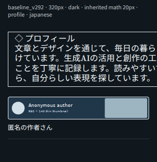
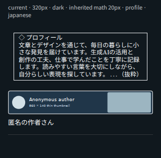

# 2.9.3：タグ記事の選択・紹介文字・区切り線の修正

変更前は **2.9.2 / `410c7d4d63f1cda7362d77cda645940f39a0b0ec`**。利用者の実際のnote画面で、紹介枠の右はみ出し、サムネイルに対して大きい文字、区切り線の欠落を確認した。

## 誤っていた点

1. `#`とマガジンで見つけた記事を、その作者の別の最新記事へ切り替えていた。人物IDが同じでも、指定した記事の条件を満たすことにはならない。
2. 紹介枠は相対文字サイズの `scriptsize` と26文字固定の折り返しだった。noteの文字サイズを継承すると、スマホ幅を超えた。既存の検査は生成文字と取得元を確認していたが、この新しい数式枠の実描画を測っていなかった。
3. 通常の`#`・記事スキ・マガジンのcore経路には、画像後に区切り線を挿入する処理が無かった。履歴経路にある処理を全経路で実行していると扱ってはいけなかった。

## 記事の条件を守る

- **#は、そのタグが実際に付いた記事を選ぶ。** 作者の別の最新記事に置き換えない。本文中の言及や似た長いタグ名では採用しない。
- 生の記事詳細の `hashtag_notes[].hashtag.name` など、割り当てタグのデータを照合する。実際の公開note APIでこの形式を確認した。タグ情報が取れない場合を確認済みにしない。
- 最新は検索で見つけたタグ付き記事。固定→最新／固定のみでも、固定記事に同じタグが付くことを確認する。固定が対象外なら前者はタグ付き記事へ戻り、後者は対象外／未確認の内訳を残す。
- 最初は、確認できた検索範囲内で古い条件一致記事を選ぶ。取得上限や継続情報不足があれば「確認範囲内」と表示し、全履歴の最初だと断定しない。
- マガジンも収録記事を対象とする。未収録の作者最新記事へ切り替えない。固定記事の所属は一覧または明示的な所属キーで確認する。
- 記事スキ入力は、その記事にスキした人の紹介であり、従来の人物ごとの4つの記事選択を維持する。
- 複数#・他入力との併用、上から優先、人物重複除外、件数／全数を維持。最初のタグで不適格だっただけで、別のタグに合う同じ人まで除外しない。

選択後の検査にもタグ条件を追加した。記事詳細から独立して残したタグを、対象の記事IDと結び付ける。明確な不一致は `TAG_SCOPE` として保存し、OFF・再読み込みでも既知の保留を消さない。再確認時にタグ材料が欠けていれば、以前の保留を合格に変えない。

## 表示と区切り線

紹介文の既存の118文字の抜粋をさらに短縮せず、`tiny` と表示枠・継承文字サイズに応じた折り返しへ変更した。URL・幅広い英字・絵文字・手動改行を保持する。サムネイル・画像リンク・キャプション・名前・中型の構図は変更しない。

新しい通常経路では、画像・名前キャプションの直後に、所有記録付きの区切り線を挿入する。手動の区切り線を勝手に採用しない。HR型が無い場合だけ、所有記録付きの代替段落を使う。

HRの後で次の画像位置がずれるケースも、実ProseMirrorで再現して修正した。必要な場合だけ作る一時段落は、自身が作った実体だけを除去する。画像が完成した後に線の処理が失敗しても、その画像を記録して再送を防ぐ。通知カードだけの削除では線を保持し、全削除では所有した線だけを削除する。

## 貼付済み部分の修正

**品質検査の詳細 →「今回分の表示を整える」→ 内容確認 →「この修正を適用」**。

この操作は自動実行しない。今回作った画像に直接対応する紹介段落だけを小さい表示へ変え、欠けた区切り線を追加する。画像の再アップロード、記事の取り直し、通知カードの再生成はしない。元の文章、手動の同文段落・線、画像・名前・リンク・カード・既知の保留を保持する。

確認後に本文・記事・保存記録が変わった場合、所有関係が曖昧な場合、処理中／通知カード変換が未確定の場合は適用しない。適用後に例外が出ても、実際に適用された本文に対応する所有記録を保存し、下書き保存は未確認と表示する。

**表示修正では選択済みの記事を別記事へ変更しない。** 2.9.2で選ばれた記事自体をタグ条件から選び直す場合は、「今回分を全削除」してから同じ入力で新規作成する。入力・件数・表示設定は残る。

## 何を検査できるか

新しい検査は、対象のPM位置と所有記録に対応する段落・画像だけを見る。接続済みのKaTeX描画があれば、文字の実境界、実文字サイズ、枠・画像に対する横幅、高さ、局所的な切り詰めを測る。対象画像の直後に区切り線があるかも確認する。

生の数式文字しか無い、描画前、DOMが取得できない、所有記録と対応しない場合は **未実施／材料不足**。生成時の改行計算だけで、実際の表示が確認済みとはしない。大きさや改行の候補だけで人物不一致にしたり、自動で書き換えたりしない。

エディタで測れた表示と、公開後の読者ページの表示は区別する。公開ページやスマートフォン実機を自動確認済みと表示する機能ではない。

## 実行結果

最終全体回帰は **748件中741成功、既存の旧仕様7失敗、skip 0**。その後の限定的な修正と追加検証を含め、最終配布物で関連 **115件すべて成功、skip 0**。旧7件は2.9.1以前から同じ旧v1.7.1固定仕様の失敗で、削除・成功固定への変更はしていない。

新しい検証には、実際の2.9.2出力を読み込んだ修復、適用前後の例外、保存失敗、同文の手動段落、手動HR、区切り線処理失敗、停止再開、元画像・リンク・カードの保持、タグなし最新記事／本文言及／似たタグ名／情報欠落／生投稿者不一致を含む。

**実Chromium・実KaTeX・日本語フォントで、旧版144例と修正版144例を描画した。**

| 条件 | 修正版の測定結果 |
|---|---|
| 画面幅320／360／390／430、白黒背景、通常16／20px、プロフィール／要約、和文・幅広い英字・手動改行 | 96例で横はみ出し0。最大文字12.1px、最大枠高109.9px |
| 同じ条件で継承文字サイズ32px | 48例で横はみ出し0。ただし文字19.36px・高い枠になるケースは実測の確認候補。小ささまで合格としない |
| 旧2.9.2 | 実際の右はみ出しを再現。旧版を失敗させる検証自体も実行 |

測定値と匿名の比較画像は [mobile-layout-v293/layout-report.json](mobile-layout-v293/layout-report.json)。これは独立した読者画面の模擬描画であり、実noteのアップロードやスマホ実機の確認ではない。利用者の添付画像・実名は公開資料に含めていない。

速度の最終計測は `BENCHMARK_293_20261101.json` に記録した。200人＋実績1件、各版3回の中央値。実PM/canvas・実時計、APIは1要求20msの模擬通信、アップロード・保存は模擬機能であり、スマホの実測ではない。

| 入力 | 2.9.2 | 2.9.3 | 全体時間の差 |
|---|---:|---:|---:|
| # | 8.674秒 | 5.416秒 | −37.56% |
| #＋マガジン＋記事スキ | 9.932秒 | 5.909秒 | −40.50% |

#の抽出単体は1.701→1.709秒（+0.47%）、複合は1.664→1.330秒。タグが付いた記事へ選択を修正した結果、要求数は#で612→412、複合で608→478となった。全12採用測定で、201画像・実績末尾・保存成功・検査継続を確認。新版では毎回201本の直後HRと201回の必須境界検査を確認した。

旧版と最適化前の試作版で30ms検査予算超過が出た3試行は無効として保存し、採用値へ混ぜていない。#の有効比較は同じプロセスで交互に測定。複合は蓄積したVM/GC状態を避けるため両版とも各試行を新しいNodeプロセスで実施し、同じ開始条件・予熱なし・バランスした版順で測定した。混合条件と#条件の絶対時間を直接比較する用途ではない。予算や製品の検査動作を緩めず、新しい完成版での検査故障は0だった。通常画像の追加タイマーは20msから0msへ短縮し、処理の区切りではイベントループへ制御を返す。note正規処理の完了・保存確認・一時停止の確認を終えてから次へ進む。通知カードの200ms間隔は維持する。検査のための追加通信・人工的な待機・全件再取得は追加しない。タグ確認で使った記事詳細は生成時にも再利用する。区切り線の所有記録比較は、異なる画像IDを先に除外する。200件分の比較でURL解析が旧関数80,000回から0回になった。最後の速度変更についても関連49件を実行し、すべて成功した。

## ファイルと戻し方

| ファイル | 変更 |
|---|---|
| `public/note-profile-card-paster-content-v292.js` / `scripts/profile-card-content-v292.mjs` | 小さい紹介表示・幅に応じた折り返し・旧保存文字列との互換 |
| `scripts/profile-card-source-scope-v293.mjs` | タグ付き記事／マガジン収録記事の選択、詳細キャッシュ |
| `scripts/profile-card-dividers-v293.mjs` | 通常経路の所有済み区切り線と挿入位置・再開 |
| `scripts/profile-card-layout-repair-v293.mjs` | 本人が選んだ場合だけ行う、所有済み表示の修正 |
| `public/note-profile-card-paster-quality-v290.js` / `scripts/profile-card-quality-{instrument,refresh}.mjs` | 実DOMの表示検査、線の確認、タグ条件と保留、修復の操作欄 |
| ビルダー、2つの生成配布物、2つの更新案内 | 2.9.3へ整合 |
| 新しいv293テスト、共通fixtureと現行配布・記事選択テスト | 実際のタグデータ、旧出力、修正・失敗・再開の回帰 |
| `scripts/render-profile-card-layout-v293.mjs` / 今回の報告・測定・匿名画像 | 実ブラウザーの再現と検証記録 |

INSIGHT本体・DB・認証・MUUMEI・ゲーム・購入専用版・歴史的なcore/v22モジュールは変更していない。

戻す場合は2.9.3のコミットだけをrevertし、`node scripts/build-profile-card-standalone.mjs` で再生成する。main全体を過去へresetしない。[変更前2.9.2の配布](https://raw.githubusercontent.com/mumei-s/note-insight/410c7d4d63f1cda7362d77cda645940f39a0b0ec/public/note-profile-card-likes300-fix-v220.user.js)も残るが、今回の表示・タグ選択の不具合を含む。更新だけで既存本文を一括変更しない。
